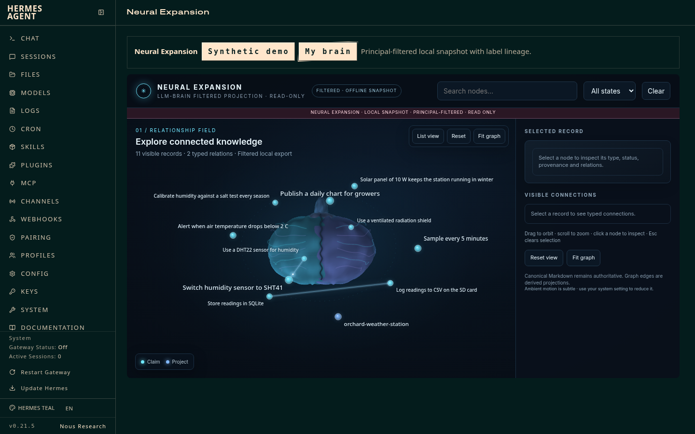
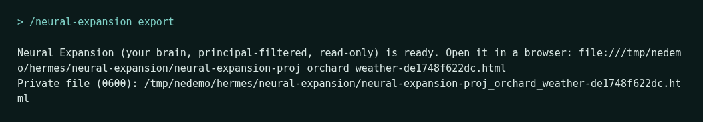
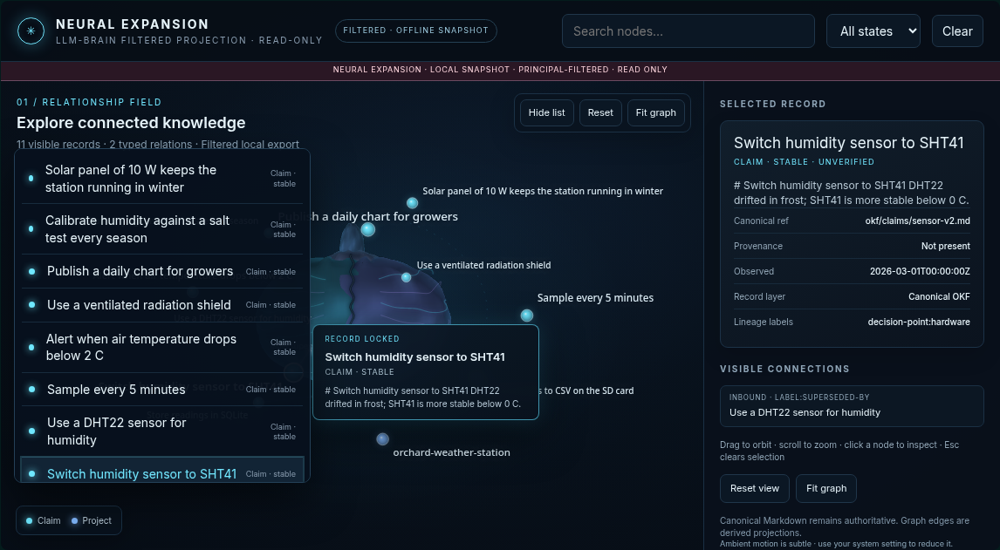

# LLM-Brain

<p align="center">
  
</p>

[](https://github.com/w00ch3a/LLM-Brain/releases)
[](LICENSE)
[](references/architecture.md)

**Plain-Markdown project memory for AI agents, with the evidence behind every claim.**

LLM-Brain gives Codex, Claude Code, Gemini CLI, Hermes Agent and other agents a
shared memory that lives in ordinary files. No database, no daemon, no hosted
service.

<p align="center">
  <a href="#start-here">Start here</a> ·
  <a href="#why-it-helps">Why it helps</a> ·
  <a href="#quick-start">Quick start</a> ·
  <a href="#hermes-and-neural-expansion">Hermes</a> ·
  <a href="#label-lineage">Lineage</a> ·
  <a href="#upgrading">Upgrading</a> ·
  <a href="#more-documentation">Docs</a>
</p>

<p align="center">
  
  <br><sub>Neural Expansion inside the Hermes dashboard (demo brain, fictional content).</sub>
</p>

## Start here

| If you want to… | Go to… |
|---|---|
| Install with safe defaults | [`install_prompt.md`](install_prompt.md) |
| Read the full guide (every command and setting) | [`docs/guide.md`](docs/guide.md) |
| Understand storage and authority | [`references/architecture.md`](references/architecture.md) |
| Connect Hermes memory | [`integrations/hermes/llm-brain/README.md`](integrations/hermes/llm-brain/README.md) |
| Upgrade or publish safely | [`skills/llm-brain-upgrade/SKILL.md`](skills/llm-brain-upgrade/SKILL.md), [`RELEASING.md`](RELEASING.md) |

The README is the versioned front door. Details live in the linked guides, so
they stay reviewable with the code. Examples use placeholders and fictional
data.

## Why it helps

- **Agents remember decisions, conventions and corrections** across sessions,
  and cite the source file for each.
- **Measured with a real agent.** In our memory-on versus memory-off runs
  (Codex, 3 repeats per task):
  - coding tasks that depend on project memory: **100%** pass with memory,
    **3%** without;
  - research recall tasks: **27%** with memory at first, **67%** after the
    v0.8.2 recall fixes (10% without memory);
  - no task scored worse with memory on. Full tables and costs:
    [`docs/real-eval-results.md`](docs/real-eval-results.md).
- **Inspectable and portable.** Knowledge is Markdown in
  [Open Knowledge Format v0.2](https://github.com/GoogleCloudPlatform/knowledge-catalog/blob/3fcbb9f828c2f23d109c855ee403c3a4c81f3a96/okf/SPEC.md);
  raw sources, review decisions and a hash-chained audit log sit beside it.
- **Nothing is silently forgotten.** Retraction is preview-then-confirm, and
  maintenance reports are derived data that never delete or promote memory.

Safe defaults: Current-state retrieval is opt-in (`--intent current_state`),
and `LLM_BRAIN_COMMITMENT_POLICY=shadow` is the default commitment policy. See
the [guide](docs/guide.md#retrieval-and-memory-control).

## Quick start

**Easiest:** give [`install_prompt.md`](install_prompt.md) to your agent and
choose **Install it for me**. It installs a checksum-verified release and
tests it.

**By hand** (Bash, Python 3 and pinned PyYAML):

```bash
git clone https://github.com/w00ch3a/LLM-Brain.git && cd LLM-Brain
python3 -m venv .venv
.venv/bin/pip install --require-hashes --no-binary PyYAML -r requirements-okf.lock
export LLM_BRAIN_OKF_PYTHON="$PWD/.venv/bin/python"

brain="./bin/llm-brain --root /path/to/llm-brain-vault"
$brain project ensure /path/to/repository
$brain search PROJECT_ID "current task" --require-evidence
$brain pack build PROJECT_ID --task "current task" --budget-tokens 4000
```

The plugin archive also installs into Codex, Claude Code and Gemini CLI; see
[Install](docs/guide.md#install).

## Hermes and Neural Expansion

**Memory provider.** Unpack the release's `llm-brain-VERSION-hermes.tar.gz`
into `$HERMES_HOME/plugins/`, then:

```bash
hermes memory setup llm-brain
hermes memory status
```

Settings go in `$HERMES_HOME/llm-brain.json` (`vault_root`, `cli_path`,
`project_id`, …). Details: [Hermes plugin guide](integrations/hermes/llm-brain/README.md).

**Neural Expansion** is a read-only, offline graph view of your memory. To use
it inside Hermes, add `llm-brain` to `plugins.enabled` in `config.yaml` and
restart Hermes. You get:

- `/neural-expansion` builds the synthetic demo; `/neural-expansion export`
  builds this profile's brain once `"neural_expansion_export": true` is set in
  `llm-brain.json`. The reply is a link to a private (`0600`) page under
  `$HERMES_HOME/neural-expansion/`.
- A **Neural Expansion** dashboard tab (loopback clients only, sandboxed
  iframe, no network access).

<p align="center">
  
</p>

> **Profiles:** if llm-brain lives in a named profile
> (`~/.hermes/profiles/NAME`), enable it in that profile's `config.yaml`
> **and** in the root `~/.hermes/config.yaml`. The dashboard serves tab files
> using the root config, so otherwise the tab is missing or blank.

Exports are principal-filtered and never written inside the vault. Don't
share, sync or serve them. More: [`neural-expansion/README.md`](neural-expansion/README.md),
[`neural-expansion/PRIVACY.md`](neural-expansion/PRIVACY.md).

## Multi-user brains

Two people on one server: give each person their own OS account and brain, and
run one stdio MCP server per person over SSH. The OS keeps the brains apart;
nothing listens on a port.

```json
{"mcpServers": {"llm-brain": {"command": "ssh",
  "args": ["-T", "alex@server", "~/.local/bin/llm-brain", "mcp", "serve", "--brain", "~/brain"]}}}
```

Setup, forced-command SSH keys and the single-account trade-offs:
[Two people, one server, two brains](docs/guide.md#two-people-one-server-two-brains).

## Label lineage

Memory changes are recorded as labels in an append-only, hash-chained ledger,
so you can see where a decision changed without anything being deleted.

```bash
llm-brain label add PROJECT okf/claims/sensor-v2.md decision-point:hardware --reason "sensor choice"
llm-brain lineage show PROJECT --decision hardware
```

```text
Tree:
  Use a DHT22 sensor for humidity [okf/claims/sensor-v1.md] {superseded-by, superseded-by:okf/claims/sensor-v2.md}
    └─ Switch humidity sensor to SHT41 [okf/claims/sensor-v2.md] {decision-point:hardware}
Timeline (* = decision tree changed here):
 * 2026-03-01T00:00:00  supersedes  okf/claims/sensor-v2.md — okf/claims/sensor-v1.md (Use a DHT22 sensor for humidity)
```

Labels also show in Neural Expansion's detail panel:

<p align="center">
  
</p>

`invalidate preview|apply` marks related records KEEP, STALE, REPLACE or
UNKNOWN, and search and packs accept `--label` / `--without-label`. See the
[v0.9.0 notes](docs/releases/v0.9.0.md).

## Upgrading

```bash
./bin/llm-brain upgrade check --all --host auto --target VERSION
./bin/llm-brain upgrade apply --all --host auto --target VERSION --plan-hash HASH
./bin/llm-brain upgrade verify --receipt RECEIPT
```

Upgrades keep a backup and a rollback tree and verify before cutover; ordinary
use never migrates a live vault. Notes for older standalone installs:
[Upgrade](docs/guide.md#upgrade). Release notes: [`docs/releases/`](docs/releases/).

## More documentation

- [Full guide](docs/guide.md): CLI tour, retrieval controls, MCP server,
  governed maintenance, safety boundaries
- [Architecture](references/architecture.md) · [Evaluation harness](docs/evaluation.md) ·
  [Real-agent results](docs/real-eval-results.md)
- [Changelog](CHANGELOG.md) · [Releasing](RELEASING.md) ·
  [Contributing](CONTRIBUTING.md) · [Security](SECURITY.md)

Development: `bash tests/release-readiness-self-check.sh`. Licence: [LICENSE](LICENSE).
